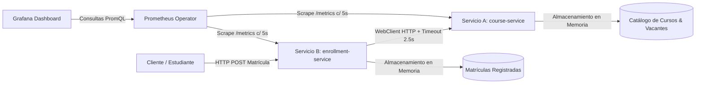

# Microservicios Java con Monitoreo en Kubernetes (Prometheus & Grafana)

[](https://www.oracle.com/java/)
[](https://spring.io/projects/spring-boot)
[](https://kubernetes.io/)
[](https://prometheus.io/)
[](https://grafana.com/)

Proyecto final de observabilidad y microservicios en Kubernetes para **Valle Grande**. Sistema distribuido construido desde cero absoluto, desplegado sobre Minikube y completamente instrumentado con **Micrometer**, **Prometheus**, **Grafana** y **AlertManager**.

---

## 🏢 1. Dominio de Negocio

El sistema modela una **Plataforma Educativa Digital** orientada a la gestión académica y comercial:



* **Servicio A (`course-service`, Puerto 8081):**
  * Catálogo de cursos disponibles, instructores, precios y control de vacantes.
  * Almacenamiento en memoria mediante `ConcurrentHashMap`.
  * Soporta inyección de retardo artificial vía variable `ARTIFICIAL_DELAY_MS` y expone métrica Gauge.
* **Servicio B (`enrollment-service`, Puerto 8082):**
  * Procesa solicitudes de matrícula estudiantil.
  * Consume `course-service` mediante `Spring WebClient` con timeout configurado a 2500 ms.
  * Maneja errores y timeouts de forma controlada respondiendo HTTP 504.
  * Almacenamiento en memoria de matrículas emitidas.

---

## 📁 2. Estructura del Repositorio

```text
.
├── microservices/
│   ├── course-service/           # Microservicio A (Java 17, Spring Boot 3, Maven, Dockerfile)
│   └── enrollment-service/       # Microservicio B (Java 17, Spring WebClient, Dockerfile)
├── k8s/
│   ├── namespace.yaml            # Namespace valle-grande
│   ├── monitoring-values.yaml    # Configuración personalizada de kube-prometheus-stack
│   ├── course-service/           # Deployment, Service (NodePort) y ServiceMonitor
│   ├── enrollment-service/       # Deployment, Service (NodePort) y ServiceMonitor
│   └── prometheus-rules.yaml     # Reglas de alerta en PromQL
├── load-testing/
│   └── stress.sh                 # Generador de tráfico y pruebas de carga parametrizables
├── scripts/
│   ├── setup.sh                  # Despliegue 100% automatizado desde cero
│   └── teardown.sh               # Limpieza y destrucción de recursos
├── docs/
│   ├── informe.md                # Informe técnico con respuestas conceptuales y casuísticas
│   └── grafana-dashboard.json    # Dashboard de Grafana exportado con 6 paneles
└── README.md
```

---

## ⚙ 3. Prerrequisitos e Instalación de Herramientas

### Comandos de instalación para Linux (Fedora / RHEL):
```bash
# Docker / Podman
sudo dnf install -y podman podman-docker

# Minikube
curl -LO https://storage.googleapis.com/minikube/releases/latest/minikube-linux-amd64
sudo install minikube-linux-amd64 /usr/local/bin/minikube && rm minikube-linux-amd64

# kubectl
sudo dnf install -y kubernetes-client

# Helm
sudo dnf install -y helm
```

---

## 🚀 4. Despliegue Automatizado en 1 Comando

Para desplegar todo el ecosistema (iniciar Minikube, instalar Prometheus y Grafana, compilar imágenes y desplegar microservicios):

```bash
chmod +x scripts/*.sh load-testing/*.sh
./scripts/setup.sh
```

---

## 🌐 5. URLs y Acceso a los Servicios

Una vez finalizado el script, obtén la IP de Minikube (`minikube ip`):

| Servicio | URL | Credenciales | Descripción |
| :--- | :--- | :--- | :--- |
| **📊 Grafana** | `http://<MINIKUBE_IP>:31000` | User: `admin` / Pass: `AdminPassword2026!` | Paneles y métricas visuales |
| **🔥 Prometheus** | `http://<MINIKUBE_IP>:30090` | Acceso directo | Servidor de métricas y `/targets` |
| **🚨 AlertManager** | `http://<MINIKUBE_IP>:30903` | Acceso directo | Gestor de alertas |
| **🎓 Course Service** | `http://<MINIKUBE_IP>:30081/api/courses` | - | Servicio A (Cursos) |
| **📝 Enrollment Svc** | `http://<MINIKUBE_IP>:30082/api/enrollments` | - | Servicio B (Matrículas) |
| **📈 Metrics Svc A** | `http://<MINIKUBE_IP>:30081/metrics` | - | Endpoint de raspado Prometheus |
| **📈 Metrics Svc B** | `http://<MINIKUBE_IP>:30082/metrics` | - | Endpoint de raspado Prometheus |

> **Importar el Dashboard en Grafana:**
> 1. Abre `http://<MINIKUBE_IP>:31000` e inicia sesión.
> 2. En el menú lateral, ve a **Dashboards** > **New** > **Import**.
> 3. Carga el archivo [`docs/grafana-dashboard.json`](docs/grafana-dashboard.json).

---

## 🧪 6. Ejecución de las 3 Casuísticas de Monitoreo

### 🔴 Casuística 1: El Servicio Caído (CrashLoopBackOff)
* **Activar:**
  ```bash
  kubectl set env deployment/course-service SIMULATE_CRASH=true -n valle-grande
  ```
* **Observación:** El pod entra en `CrashLoopBackOff`, Prometheus lo detecta como `DOWN` (`up == 0`) y se activa la alerta `CourseServiceDown`.
* **Solución:**
  ```bash
  kubectl set env deployment/course-service SIMULATE_CRASH=false -n valle-grande
  ```

---

### 🟡 Casuística 2: El Servicio Lento (Timeouts en Cascada)
* **Activar retardo de 4 segundos en Servicio A:**
  ```bash
  curl -X POST http://$(minikube ip):30081/api/courses/admin/delay \
       -H "Content-Type: application/json" -d '{"delayMs": 4000}'
  ```
* **Generar tráfico hacia Servicio B:**
  ```bash
  ./load-testing/stress.sh -n 20 -m timeout
  ```
* **Observación:** En Grafana el panel de *Delay Inyectado* sube a 4000 ms, la latencia de Servicio B supera los 2.5s y las peticiones fallan con HTTP 504 Gateway Timeout incrementando `enrollment_timeouts_total`.
* **Solución:**
  ```bash
  curl -X POST http://$(minikube ip):30081/api/courses/admin/delay \
       -H "Content-Type: application/json" -d '{"delayMs": 0}'
  ```

---

### 🟠 Casuística 3: Agotamiento de Vacantes (Alerta de Negocio)
* **Activar racha de matrículas en curso con pocos cupos:**
  ```bash
  ./load-testing/stress.sh -n 15 -i 0.1 -m exhaust
  ```
* **Observación:** El medidor Gauge de vacantes disponibles desciende por debajo de 5, disparando la alerta `CourseSeatsExhaustedCritical`.
* **Solución:** Crear un nuevo curso o recargar vacantes vía POST en `/api/courses`.

---

## 🧹 7. Limpieza de Recursos (Teardown)

* Eliminar despliegues y monitoreo conservando Minikube:
  ```bash
  ./scripts/teardown.sh
  ```
* Eliminar todo incluyendo el clúster Minikube:
  ```bash
  ./scripts/teardown.sh --delete-cluster
  ```
